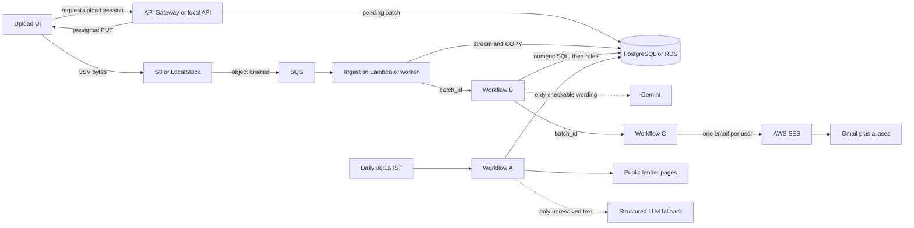

# Loan Eligibility Engine

Event-driven personal-loan eligibility pipeline. A browser uploads a user CSV
directly to object storage. A worker loads that batch into PostgreSQL. n8n
discovers public loan products, matches the batch, and sends one SES email per
user to a Gmail plus alias.

The same Python ingestion code runs locally, against LocalStack, and on AWS.
n8n owns product discovery, matching, and notification.

## Architecture



Locally, Docker Compose runs PostgreSQL 17, LocalStack S3/SQS, the FastAPI
upload service, a polling ingestion worker, and n8n. On AWS, `serverless.yml`
maps that boundary to API Gateway, two Lambda functions, S3, SQS, and private
RDS. The CSV never passes through the API. n8n stays self-hosted either way,
and SES is called by the n8n AWS SES node.

## Repository

| Path | Role |
| --- | --- |
| `docker-compose.yml` | Local PostgreSQL, LocalStack, API, worker, and n8n |
| `backend/` | Upload API, streaming CSV ingestion, and thin AWS handlers |
| `backend/app/aws_api.py` | API Gateway adapter around the FastAPI app |
| `backend/app/aws_ingest.py` | SQS adapter around the existing ingestion functions |
| `backend/app/aws_schema.py` | Applies `db/schema.sql` to private RDS |
| `ui/` | Upload page served by the API |
| `db/schema.sql` | Application schema |
| `db/init/` | Local role and database bootstrap |
| `localstack/init/` | Local bucket, queue, CORS, and S3 notification |
| `n8n/workflows/*.json` | Credential-free workflow exports |
| `serverless.yml` | AWS resources and IAM |
| `.env.example` | Placeholder configuration only |

## Prerequisites

- Docker Desktop with Compose
- Ports `4566`, `5678`, and `8000` free for the local stack
- Node.js 18+ only if you deploy the optional AWS stack
- An AWS account only if you deploy. The local demonstration does not need one

## Local setup

1. Copy `.env.example` to `.env`.
2. Set `POSTGRES_SUPERUSER_PASSWORD`, `N8N_ENCRYPTION_KEY`,
   `N8N_WEBHOOK_SECRET`, `GEMINI_API_KEY`, and
   `NOTIFICATION_TEST_EMAIL_BASE`. Leave `N8N_MATCH_WEBHOOK_URL` as
   `http://n8n:5678/webhook/user-loan-matching`.
3. Do not commit `.env`. Do not paste the Gemini key or webhook secret into a
   workflow export, a log, or this file.
4. Start the stack:

```bash
docker compose up --build -d
```

5. Apply the schema on a database that was created before the current
   `db/schema.sql`. A fresh volume already runs it from `db/init`.

```bash
MSYS_NO_PATHCONV=1 docker compose exec -T postgres psql -U postgres -d loan_engine -f /opt/loan-engine/schema.sql
```

Git Bash on Windows rewrites `/opt/...` unless `MSYS_NO_PATHCONV=1` is set.

6. Open the upload page at <http://localhost:8000> and n8n at
   <http://localhost:5678>.

Compose publishes LocalStack on `4566`, n8n on `5678`, and the API on `8000`.
PostgreSQL is only on the Compose network. LocalStack is limited to S3 and
SQS. Images are pinned: `postgres:17-alpine`, `localstack/localstack:4.9.2`,
and `n8nio/n8n:2.43.6`.

An empty S3 endpoint and empty access keys mean “use the AWS API and the
caller’s IAM role.” Compose sets `http://localstack:4566` inside the
containers, `http://localhost:4566` for the browser presigned URL, and the
LocalStack test keys. Those values stay out of `serverless.yml`.

## Database

`db/init/00-create-databases.sql` creates the local `loan_app` and `n8n`
roles, the `loan_engine` and `n8n` databases, and applies `db/schema.sql`.
n8n stores its own data in the `n8n` database. Application tables live in
`loan_engine`:

| Table | Purpose |
| --- | --- |
| `ingestion_batches` | One uploaded object. Status moves `pending` → `processing` → `completed` or `failed`. |
| `users` | CSV rows for that batch. Unique on `(batch_id, user_id)`. |
| `loan_products` | One normalized profile per source product. Unique on `(source_name, source_url, product_name)`. |
| `matches` | One eligibility result per user and product. `notified_at` stays null until SES accepts the email. |
| `matching_runs` | Counts that show how much work SQL, rules, and the model each did. |

Required CSV columns are exactly `user_id`, `email`, `monthly_income`,
`credit_score`, `employment_status`, and `age`. A null product limit means the
source did not state that limit. It does not reject the user. `schema.sql` is
additive, so applying it again does not drop products or matches.

The local application password in Compose is `local-app-password`. The n8n
database password is `local-n8n-password`. Both are local development values.

## n8n credentials

Import each JSON file from `n8n/workflows/`. The files contain no credential
IDs, access keys, or webhook secrets. After import, create these credentials
in the n8n UI and attach them yourself:

| Credential | Used by | Settings |
| --- | --- | --- |
| Loan Engine Postgres | Workflows A, B, and C | Host `postgres`, port `5432`, database `loan_engine`, user `loan_app`, password `local-app-password`, SSL off |
| Match Webhook Secret | Workflow B ingestion webhook, Workflow B’s notification handoff, Workflow C webhook | Header auth, name `X-Webhook-Secret`, value equal to `N8N_WEBHOOK_SECRET` |
| Gemini API Key | Workflow B qualitative check | Header auth, name `x-goog-api-key`, value from `GEMINI_API_KEY` |
| AWS SES | Workflow C send node | AWS credential, region `us-east-1`, no custom endpoint. IAM user with `ses:SendEmail` |

The optional product-discovery fallback uses a Header Auth credential named
for OpenAI: header `Authorization`, value `Bearer <key>`. Current sources
leave that path disabled, so the key is not required for the demonstration.

Publish a workflow after its credentials are attached. n8n runs the published
version. Import alone does not register the production webhook. Restart n8n
after the first publish if a webhook returns 404.

`N8N_BLOCK_ENV_ACCESS_IN_NODE` is `false` so Workflow C can read
`NOTIFICATION_TEST_EMAIL_BASE` and `SES_FROM_EMAIL`. Recreate the n8n
container after changing those values. Do not rotate `N8N_ENCRYPTION_KEY`
after credentials exist; n8n cannot decrypt them with a different key.

## Workflow A — loan product discovery

`n8n/workflows/loan-product-discovery.json` has a daily schedule at 06:15
Asia/Kolkata and a manual trigger.

```text
Manual trigger or Daily 06:15 IST
  -> Source configuration
  -> Fetch public lender page
  -> Deterministic extraction and cleanup
  -> Needs LLM fallback?
       yes -> Build scoped LLM request
            -> LLM structured extraction
            -> Parse and validate LLM JSON
       no  -> Validate normalized profile
  -> Profile valid?
       yes -> PostgreSQL upsert loan product -> Record upsert outcome
       no  -> Record failure outcome
  -> Collect outcomes
  -> Execution summary
  -> Prepare deactivation input
  -> Deactivate removed products
  -> Final execution summary
```

Source configuration emits three records: Discover Personal Loan, LendingPoint
Personal Loan, and Upgrade Personal Loan. Each record has a stable source
name, URL, product name, currency, extraction profile, and
`allow_llm_fallback: false`.

Fetch retries the public page once. Extraction removes scripts, styles, and
markup, then reads explicit APR ranges, annual-income floors, and age
wording (“at least 18 years old,” “at least 18 years of age,” or “18 years or
older”). Annual income is stored as monthly income with two decimal places.
The node keeps the matching snippet in `source_evidence`.

Validation rejects empty pages, inverted ranges, and a missing product
identity. The upsert key is `(source_name, source_url, product_name)`. A
successful sighting refreshes eligibility fields, sets `active = true`, and
moves `last_seen_at`. A source that fails this run keeps its previous active
profile. After the run, products whose identity is no longer in the source
list are set `active = false`. One failed source does not discard the others.

A normal run reports three upserts and `llm_extractions: 0`.

### Crawler strategy

This is a reviewed three-page collection, not an open crawler. There is no
browser automation, sitemap walk, or search step. A new lender is added only
after the page returns useful HTML from inside the n8n container and a
deterministic pattern is written for it. Layout-change detection is omitted;
the assignment leaves it optional. A failed fetch keeps the last good profile
instead of guessing a replacement.

| Product | Page | What the page states |
| --- | --- | --- |
| Discover Personal Loan | <https://www.discover.com/personal-loans/> | Age 18+, $25,000 minimum individual or household annual income, and an APR range |
| LendingPoint Personal Loan | <https://www.lendingpoint.com/> | Age 18+, $35,000 minimum annual income, 7.99%–35.99% APR, plus identity, banking, and residency requirements |
| Upgrade Personal Loan | <https://www.upgrade.com/personal-loans/> | Age 18+ and 7.74%–35.99% APR. No fixed income or credit-score cutoff |

### LLM boundary

The model is not asked to discover lenders, invent cutoffs, or restate numbers
the HTML parser already found. The fallback runs only when a reviewed source
sets `allow_llm_fallback` and deterministic extraction still leaves
eligibility language unresolved. The current three sources do not.

When enabled, the fallback sends cleaned excerpts capped at 6,000 characters,
requests strict JSON, and tells the model to return null for anything absent
or ambiguous. A later node rejects malformed JSON, non-numeric values, and
invalid ranges before PostgreSQL. Deterministic values win. The model may
fill only a field that is still unknown.

## Workflow B — user and loan matching

`n8n/workflows/user-loan-matching.json` starts when ingestion finishes. The
worker POSTs `{ "batch_id": "..." }` to
`http://n8n:5678/webhook/user-loan-matching` with `X-Webhook-Secret`. The
workflow accepts only a completed batch and pages it by user id. Page size is
150. It does not load every user and every product into n8n, and it does not
build the email.

```text
Ingestion webhook
  -> validate batch_id and completed status
  -> keyset page list
  -> each page:
       SQL numeric candidate join
       -> deterministic employment and qualitative classification
       -> Gemini only for wording the CSV can answer
       -> upsert matches
  -> delete unnotified matches this run no longer supports
  -> matching_runs and optimization summary
  -> POST batch_id to Workflow C
  -> notification handoff
```

The handoff calls `http://127.0.0.1:5678/webhook/user-notification` with the
same secret. If that call fails, the match rows stay saved and Workflow C can
be posted again with the same `batch_id`.

### Multi-stage optimization

The matcher does not send the full user×product set to a model.

1. **SQL.** PostgreSQL joins one page of users to active products and applies
   only hard numeric limits: minimum monthly income, credit-score minimum and
   maximum, and age minimum and maximum. A null limit is unknown, so it does
   not reject the user. Income is compared only when the product currency is
   USD. A non-USD product that states an income floor is skipped and is not
   called eligible. n8n receives the surviving candidates, not the Cartesian
   product.
2. **Deterministic checks.** Employment uses three-valued logic. An empty
   accepted-status list is `UNKNOWN`, not a pass. A recognized status outside
   the list is `FAIL` and the pair stops. An unrecognized status stays
   `UNKNOWN`. Qualitative sentences are classified the same way. SSN, address,
   residency, citizenship, visa, photo ID, bank account, credit usage, and
   payment history are `UNKNOWN` because the CSV has no such columns, and they
   are not sent to a model. An email-only requirement can pass from the email
   column. A sentence that also requires a device or an online finalization
   stays `UNKNOWN`. Numeric rules are never delegated to the model.
3. **Bounded LLM checks.** Only employment wording that is not already decided
   by a structured status list is eligible for Gemini. The model is
   `gemini-2.5-flash` at temperature 0, with a JSON schema of `PASS`, `FAIL`,
   or `UNKNOWN`. One request covers up to 25 criteria, grouped by user. The
   response is accepted only when the check id, user id, and product id match
   the request. A `PASS` that depends on a missing attribute becomes
   `UNKNOWN`. A `FAIL` that tries to re-apply income, credit, or age is
   ignored. If the call fails, those criteria stay `UNKNOWN` and the numeric
   result is unchanged.

A match is stored when the pair survived every numeric and deterministic
`FAIL` and the model did not return `FAIL`. `UNKNOWN` does not become a pass,
and it does not by itself reject a pair whose supplied fields already passed.
`match_reason` says the result is likely eligibility from the supplied data,
not a lender approval. `match_method` is `deterministic` or
`deterministic+llm`.

The upsert key is `(user_record_id, product_id)`. After a successful run,
unnotified rows for that batch that this run did not refresh are deleted.
Notified rows are left in place. A failed page does not delete existing
matches.

Each run writes one `matching_runs` row:

| Count | Meaning |
| --- | --- |
| `users_in_batch` | Users in the completed batch |
| `theoretical_pairs` | Users × active products |
| `sql_candidates` | Pairs left after numeric SQL |
| `deterministic_remaining` | Pairs left after deterministic failures |
| `qualitative_pairs` | Remaining pairs whose product has qualitative wording |
| `qualitative_llm_pairs` | Pairs whose wording is actually checkable |
| `llm_calls` | Gemini requests |
| `matches_written` | Eligible pairs upserted |

For Discover, LendingPoint, and Upgrade, residency, identity, and bank
requirements stay `UNKNOWN` without a model call. A normal batch records
`llm_calls = 0`.

## Workflow C — user notification

`n8n/workflows/user-notification.json` reads unnotified matches for the posted
`batch_id` only. The query joins `matches`, `users`, and `loan_products`
where `notified_at IS NULL`. It does not select `users.email`.

```text
Notification webhook
  -> read batch_id
  -> load unnotified matches, grouped by user
  -> build one HTML email per user
  -> unnotified rows?
       yes -> AWS SES -> classify the SES result -> set notified_at
       no  -> summary
```

One user with several new matches gets one email. The body lists each product
name, interest-rate range, and stored match reason. The wording says the
result is likely eligibility from the supplied data and is not a guaranteed
approval or a lender decision.

The recipient is always derived from `NOTIFICATION_TEST_EMAIL_BASE`. A base
of `owner@gmail.com` and user id `strong` becomes
`owner+loan-strong@gmail.com`. `SES_FROM_EMAIL` is the verified sender. When
it is empty, the workflow uses the Gmail base. The workflow stops before SES
if either address is missing, is not a Gmail base, or looks like a sample CSV
address. The CSV email is never selected.

`notified_at` is set only when SES returns a `MessageId`, the send status is
`sent`, and the updated row count matches the products in that email. A
failed send leaves those rows null. A second run sends only the rows that are
still null. If any send fails, the execution ends in error after the
successful rows have already been recorded, so a retry does not resend them.

### SES sandbox and aliases

Create or update the n8n AWS credential used by **Send match email**. Region
`us-east-1`. Custom endpoints off. The IAM user needs `ses:SendEmail` and
`ses:SendRawEmail`. `serverless.yml` creates a managed policy for that, named
`loan-eligibility-engine-<stage>-n8n-ses`, but it does not create access keys.

In the SES sandbox, mail can go only to verified identities. Verifying
`owner@gmail.com` does not verify `owner+loan-strong@gmail.com`. Verify the
base address, the sender, and each plus alias you will use, or move the
account out of the sandbox. Then run a completed batch. The message should
arrive at the alias, and `matches.notified_at` should be set. Run the same
`batch_id` again and confirm `emails_sent` is 0.

```bash
curl -sS -X POST http://localhost:5678/webhook/user-notification \
  -H "Content-Type: application/json" \
  -H "X-Webhook-Secret: $N8N_WEBHOOK_SECRET" \
  -d '{"batch_id":"<completed-batch-uuid>"}'
```

## Local demonstration

1. Start Compose and confirm <http://localhost:8000/health> returns
   `{"status":"ok"}`.
2. Import and publish all three workflows with the credentials above. Publish
   Workflow C before the matching handoff, then restart n8n once.
3. In n8n, run **Workflow A - Loan Product Discovery** from **Manual trigger**.
   The final summary should show three products and zero LLM extractions.
   Query `loan_products` and confirm one active row per source. Run it again
   and confirm the row count stays three while `last_seen_at` advances.
4. Save a UTF-8 CSV:

```csv
user_id,email,monthly_income,credit_score,employment_status,age
strong,strong@example.com,8000,760,employed,35
low,low@example.com,1800,640,employed,28
young,young@example.com,5000,720,employed,17
```

5. Open <http://localhost:8000>, upload the file, and wait until the page
   shows the batch completed. The browser PUTs the file to the presigned URL.
   The API response contains a batch id, not the CSV body.
6. In n8n, open the matching execution. The optimization summary should show
   a smaller candidate set than `theoretical_pairs`, and `llm_calls` should
   be 0 for these sources. `young` fails the age-18 floor. `strong` and `low`
   match only the products whose numeric floors they pass.
7. Open the notification execution started by the handoff. With a real SES
   credential and verified aliases, each eligible user receives one email at
   `...+loan-<user_id>@gmail.com`. `notified_at` is set only for those rows.
   Post the same `batch_id` again and confirm no second email.

Workflow A can also be left published so the 06:15 Asia/Kolkata schedule runs
without a manual click.

## AWS deployment

Do not deploy this stack unless you accept the charges. It creates a NAT
gateway, an Elastic IP, and a `db.t4g.micro` PostgreSQL instance. The NAT
gateway is the costly part, on the order of a dollar a day plus data, because
a Lambda function in a private subnet has no public IP of its own. Local
Compose is the demonstration path and does not create those resources.

The template places the API, the ingestion function, and the schema function
in one private subnet. RDS uses two private subnets and accepts port 5432
only from the Lambda security group. A NAT gateway gives the functions a path
to SQS, CloudWatch, the CloudFormation response URL, and a public n8n
webhook. An S3 gateway endpoint keeps bucket traffic off the NAT. The upload
bucket blocks public access, allows browser `PUT` through CORS, and notifies
SQS for `uploads/` object-created events. A dead-letter queue receives a
message after three failed receives. The database password is generated in
Secrets Manager and injected into the functions. It is not written into git
or the stack outputs.

n8n is not part of the CloudFormation stack. From AWS, set
`N8N_MATCH_WEBHOOK_URL` to a public URL the Lambda function can reach, such
as an n8n host with a public address. `http://n8n:5678` works only inside
Compose.

```bash
npm install
export AWS_ACCESS_KEY_ID="<deployer access key>"
export AWS_SECRET_ACCESS_KEY="<deployer secret>"
export AWS_DEFAULT_REGION=us-east-1
export N8N_MATCH_WEBHOOK_URL="https://<public-n8n-host>/webhook/user-loan-matching"
export N8N_WEBHOOK_SECRET="<same value as the n8n header credential>"
npx serverless deploy
```

The database default is PostgreSQL `16.15` on `db.t4g.micro`. `16.8` is not
offered for that class. To use another available version, set
`RDS_ENGINE_VERSION` from:

```bash
aws rds describe-db-engine-versions \
  --engine postgres \
  --query "DBEngineVersions[?starts_with(EngineVersion, '16.')].EngineVersion" \
  --output text
```

Deploy prints the API URL. Open it, upload a CSV, and confirm the batch
reaches `completed` and n8n receives the `batch_id`. The schema custom
resource applies `db/schema.sql` from inside the VPC. Attach the output SES
policy to the IAM user whose keys you enter in n8n. Create those keys in the
IAM console. The template does not create them.

Remove the stack when you are finished so the NAT gateway and database stop
billing:

```bash
npx serverless remove
```

## Known source assumptions

- User income is USD. The CSV has no currency column, and the selected
  products are USD. A non-USD product with an income floor is skipped rather
  than converted.
- Credit-score cutoffs are not stated on these pages, so the stored bounds
  stay null. A generic sentence that the lender considers credit is qualitative
  text, not a numeric rule.
- Employment categories are not stated as an accepted list, so employment
  stays unknown unless a later reviewed source says otherwise.
- Identity, residency, banking, and similar requirements remain unknown.
  Unknown does not by itself reject a user who passed the supplied fields.
- A stored match is likely eligibility from the CSV. It is not an approval,
  an offer, or a lender decision.
- The three pages were chosen because they return server-rendered eligibility
  text to the n8n container. A redesigned page can fail that source until the
  extraction pattern is updated. The previous profile stays active.
- SES sandbox plus aliases are separate identities from the base Gmail
  address.
- Notification always uses the configured Gmail base. Addresses in the CSV are
  stored for matching context and are not used as recipients.

## Demonstration outline

A 5–10 minute recording can follow this order:

1. Show the diagram above and the Compose services.
2. Open Workflow A, run it manually, and show three products with zero LLM
   calls.
3. Upload the sample CSV in the browser and show the batch row count.
4. Open the matching summary and point at SQL candidates versus the
   theoretical pair count, then the deterministic result and `llm_calls`.
5. Show one received alias email and the `notified_at` values. Run the
   notification webhook again and show that nothing is resent.
