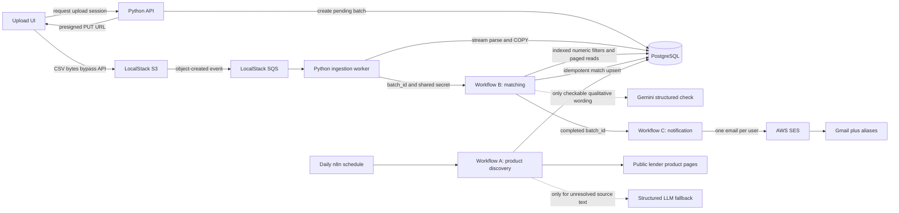

# Loan Eligibility Engine

Event-driven personal-loan eligibility pipeline built for the engineering
intern assignment in this repository.

This branch implements **Phases 1–5**:

- a local PostgreSQL database with the application schema;
- self-hosted n8n in Docker;
- local AWS-compatible S3 and SQS through LocalStack;
- a Python upload/ingestion service;
- a minimal CSV upload UI;
- direct-to-object-storage uploads and asynchronous CSV ingestion;
- a scheduled n8n loan-product discovery workflow that compiles public lender
  pages into normalized eligibility profiles and upserts them into PostgreSQL;
- an n8n matching workflow that reduces each completed batch in PostgreSQL,
  applies deterministic rules, and calls Gemini only for qualitative criteria
  the CSV can actually support;
- an n8n notification workflow that sends one AWS SES email per user to a
  Gmail plus alias and records `notified_at` only after SES accepts the send.

AWS deployment is intentionally not implemented yet.

## Local architecture



This uses the same S3 and SQS API boundaries intended for AWS. The upload
endpoint can become a small Lambda/API Gateway handler, the queue consumer can
become an SQS-triggered Lambda adapter, and PostgreSQL can become RDS. The CSV
parser and database persistence code do not depend on FastAPI or LocalStack.

## Why the upload is event-driven

The browser does not send the CSV through the backend. It first creates an
ingestion batch and receives a short-lived presigned URL, then uploads directly
to object storage. S3 emits an object-created event to SQS, and a separate
ingestion worker consumes it. The worker streams the object and uses PostgreSQL
`COPY`, so neither the browser-facing API nor the parser holds the complete
file in memory. The queue also decouples upload traffic from parsing work.

## Prerequisites

- Docker Desktop with Docker Compose
- Ports `4566`, `5678`, and `8000` available

No local Python or PostgreSQL installation is required.

## Start the local stack

1. Copy `.env.example` to `.env`.
2. Replace `POSTGRES_SUPERUSER_PASSWORD` and `N8N_ENCRYPTION_KEY` in `.env`.
3. Set `N8N_WEBHOOK_SECRET`, `GEMINI_API_KEY`, and
   `NOTIFICATION_TEST_EMAIL_BASE` in `.env`. The matching webhook URL should be
   `http://n8n:5678/webhook/user-loan-matching`. Do not commit `.env` or paste
   the Gemini key into a workflow, log, or this README.
4. Start the services:

   ```bash
   docker compose up --build
   ```

5. Open:
   - Upload UI: <http://localhost:8000>
   - n8n: <http://localhost:5678>

On the first start, PostgreSQL creates separate `loan_engine` and `n8n`
databases with separate application users. LocalStack's ready hook creates the
S3 upload bucket and SQS ingestion queue, applies browser CORS, and registers
the object-created event notification.

The application containers use fixed, private-network-only development
credentials for those two internal database users. PostgreSQL is not published
to the host. Production credentials will be supplied through AWS configuration
in the later deployment phase.

Data is persisted in named Docker volumes. To deliberately remove all local
data and rerun database initialization, stop the stack and remove its volumes
before starting it again.

## CSV contract

Files must be UTF-8 CSVs with exactly these headers (column order does not
matter):

```text
user_id,email,monthly_income,credit_score,employment_status,age
```

Every field is required. `monthly_income` must be a non-negative number;
`credit_score` and `age` must be whole numbers. A malformed row fails the whole
batch and rolls back all rows from that file. Duplicate `user_id` values within
one batch are rejected.

The UI polls the batch endpoint and displays whether processing is pending,
processing, completed, or failed, including the stored row count or validation
error.

## Phase 1–2 endpoints

- `POST /api/uploads` — creates a batch and returns a presigned upload URL.
- `GET /api/batches/{batch_id}` — returns ingestion status.
- `GET /health` — verifies that the service can reach PostgreSQL.

LocalStack S3 sends object-created messages to SQS automatically. The dedicated
`ingestion-worker` service long-polls that queue; no public event endpoint is
needed.

## Database schema

[`db/schema.sql`](db/schema.sql) defines:

- `ingestion_batches` for object/event correlation and processing state;
- `users` for validated user data;
- `loan_products` for normalized discovered products;
- `matches` for eligibility results and notification state;
- `matching_runs` for one optimization record per Workflow B execution.

The ingestion callback is idempotent: only a `pending` batch can be claimed,
and users are unique by `(batch_id, user_id)`.

Workflow A adds `income_currency` (the selected sources are USD) and
`source_evidence`. It also changes the default `qualitative_criteria` value
to a JSON array. The matcher reads that array and does not treat a missing
criterion as a rejection.
The schema file contains additive `ALTER TABLE ... IF NOT EXISTS` statements,
so running it updates an already-initialized local database without dropping
products.

## Workflow A — Loan Product Discovery

[`n8n/workflows/loan-product-discovery.json`](n8n/workflows/loan-product-discovery.json)
is an importable, inactive-by-default n8n export. It has both a daily Schedule
Trigger (06:15 Asia/Kolkata) and a Manual Trigger for demonstrations:

```text
Schedule / Manual
  -> source configuration (3 deliberately small source records)
  -> HTTP GET with retry
  -> HTML cleanup + deterministic extraction
  -> LLM fallback only for an explicitly unresolved configured source
  -> schema/range validation and employment normalization
  -> PostgreSQL parameterized upsert
  -> per-source outcomes -> execution summary
  -> deactivate products removed from the configured source list
```

The chosen pages were checked from inside the n8n container, not just in a
desktop browser. All returned HTTP 200 and expose useful server-rendered text:

| Source/product | Public page | Why it was selected |
| --- | --- | --- |
| Discover Personal Loan | [Discover](https://www.discover.com/personal-loans/) | States age 18+, $25,000 minimum individual/household annual income, and an APR range on its product page. |
| LendingPoint Personal Loan | [LendingPoint](https://www.lendingpoint.com/) | States age 18+, $35,000 minimum annual income, $7.99–$35.99 APR, and clear identity/banking/residency requirements. |
| Upgrade Personal Loan | [Upgrade](https://www.upgrade.com/personal-loans/) | States age 18+, 7.74%–35.99% APR, and clear residency/bank/email requirements; it purposefully publishes no fixed income or credit-score cutoff. |

This workflow is a small curated discovery set, not a general web crawler.
Adding a lender means first confirming that its HTML is publicly reachable from
the n8n container and then adding a reviewed source record and deterministic
pattern. That is intentional: it makes the workflow reliable and demoable
without browser automation or a separate crawler service.

### Deterministic extraction before LLM

The extraction node removes scripts, styles, markup, and excess whitespace. It
then extracts only explicit rate ranges, annual-income thresholds, and age
thresholds. Age is accepted as “at least 18 years old,” “at least 18 years of
age,” or “18 years or older,” which covers the wording used by the selected
lenders. Explicit annual income is converted to monthly income with
two-decimal precision. The node records the matching source snippets alongside
the normalized values.

The three selected pages do not require an LLM in their current form, so their
`allow_llm_fallback` configuration is `false`; a normal execution makes zero
LLM calls. This is by design, not a missing path. The fallback branch is
present for a future reviewed source whose eligibility wording cannot be
normalized safely with deterministic extraction. It runs only when that source
explicitly enables the fallback and the cleaned page still contains eligibility
language that produced no qualitative criteria:

- It passes only selected, cleaned eligibility/product excerpts (capped at
  6,000 characters), never the whole HTML page.
- It requests strict JSON Schema output and directs the model to return
  `null` for absent or ambiguous values.
- A downstream node rejects malformed JSON, bad arrays, non-numeric values,
  invalid ranges, and missing stable identity before the database node runs.
- Deterministically extracted values take precedence; the fallback may fill
  only a currently unknown field.

The fallback is written for OpenAI's Chat Completions Structured Outputs. Create
an n8n **Header Auth** credential with header name `Authorization` and value
`Bearer YOUR_OPENAI_API_KEY`, then attach it to **LLM structured extraction**
before enabling `allow_llm_fallback` on a reviewed source. The workflow export
contains no key. OpenAI's [Structured Outputs documentation](https://developers.openai.com/api/docs/guides/structured-outputs?api-mode=responses)
explains the strict JSON-schema response mode used by the fallback.

### Normalized profile and unknowns

Each valid source becomes one `loan_products` row with the following matching
shape:

```json
{
  "product_name": "LendingPoint Personal Loan",
  "interest_rate_min": 7.99,
  "interest_rate_max": 35.99,
  "minimum_monthly_income": 2916.67,
  "income_currency": "USD",
  "credit_score_min": null,
  "credit_score_max": null,
  "age_min": 18,
  "age_max": null,
  "accepted_employment_statuses": null,
  "qualitative_criteria": [
    "Government-issued photo ID required",
    "Verifiable personal bank account required"
  ]
}
```

`NULL` means *unknown/not stated*, not a failed requirement. For example,
Workflow A does not invent a credit-score cutoff for any chosen lender,
does not fabricate an age maximum, and leaves
`accepted_employment_statuses` as `NULL` unless a source explicitly names
accepted categories. A lender's generic statement that it considers credit,
income, or employment is saved as qualitative text rather than falsely turned
into a hard numeric rule. `source_evidence` is a compact JSON array of
`{field, snippet}` objects to make the stored facts explainable; it is not a
separate audit system.

The initial source set is U.S./USD only. Phase 4 should treat the existing
`users.monthly_income` field as USD when it compares it to these products.
It must not compare a different-currency upload without an explicit currency
contract or conversion step.

### Upsert, errors, and summary

The upsert's stable identity is
`(source_name, source_url, product_name)`, the existing unique key. On every
successful sighting it overwrites extracted eligibility fields/evidence, sets
`active = true`, and advances `last_seen_at`; it never inserts a duplicate
for the same source product. Array fields are sent as JSON text so PostgreSQL
receives valid `jsonb` values. After the crawl, any stored product whose
identity is no longer in the configured source list is marked `active = false`.
A source that fails during the current run stays active with its last
successful profile and its previous `last_seen_at`.

HTTP requests retry once. Bad responses, unexpected/empty HTML, malformed LLM
responses, validation errors, and database errors become a visible per-source
failure outcome and are not persisted. One bad source therefore does not
discard successful products from the other sources. The final node returns
execution-only information in this shape:

```json
{
  "sources_processed": 3,
  "products_extracted": 3,
  "products_upserted": 3,
  "llm_extractions": 0,
  "extraction_failures": 0,
  "failures": [],
  "products_deactivated": 0
}
```

## Import and run Workflow A locally

1. Start the stack with `docker compose up --build` and open
   <http://localhost:5678>.
2. Import
   [`n8n/workflows/loan-product-discovery.json`](n8n/workflows/loan-product-discovery.json).
3. Create a PostgreSQL credential in n8n using host `postgres`, port
   `5432`, database `loan_engine`, user `loan_app`, password
   `local-app-password`, and SSL disabled. Attach it to
   **PostgreSQL upsert loan product**.
4. Execute with **Manual trigger**. The final summary should report three
   upserts and zero LLM calls. Query `loan_products` and confirm one row per
   source. Run it again and confirm the row count stays at three while
   `last_seen_at` advances.
5. Configure the optional Header Auth credential only if a reviewed source is
   explicitly enabled for the LLM fallback.
6. Publish the workflow after the manual run succeeds. Publishing arms the
   daily 06:15 Asia/Kolkata schedule. Import leaves the workflow inactive so
   a source change can be inspected before that schedule starts.

## Workflow B — user and loan matching

[`n8n/workflows/user-loan-matching.json`](n8n/workflows/user-loan-matching.json)
starts when ingestion finishes. The worker POSTs `{ "batch_id": "..." }` to
`http://n8n:5678/webhook/user-loan-matching` with header `X-Webhook-Secret`.
n8n checks that header before the workflow runs. The workflow then accepts only
a completed batch and pages that batch by user id. It does not load every user
or every product into n8n.

The page size is 150 users. PostgreSQL builds the page boundaries, and each
loop iteration reads only that id range.

```text
Webhook
  -> validate batch_id and completed status
  -> keyset page list
  -> for each page:
       SQL numeric candidate join
       -> deterministic employment and qualitative classification
       -> Gemini only for employment wording the CSV can answer
       -> upsert matches
  -> delete unnotified matches this run no longer supports
  -> write matching_runs and the optimization summary
```

### Stage 1 — PostgreSQL

The candidate query joins one page of users to active products and applies only
hard numeric limits: minimum monthly income, credit-score minimum and maximum,
and age minimum and maximum. A null product limit is unknown, so it does not
reject the user. Income is compared only when the product currency is USD,
which matches this CSV contract. A non-USD product that states an income floor
is counted as skipped and is not treated as eligible.

The join runs inside PostgreSQL. n8n receives one row per page, containing the
surviving candidates, not the full user×product matrix.

### Stage 2 — deterministic rules

Employment uses three-valued logic. A null or empty accepted-status list is
`UNKNOWN`, not a pass. A recognized status outside that list is `FAIL` and the
pair stops. An unrecognized status stays `UNKNOWN` rather than being invented
into a pass.

Qualitative sentences are classified the same way:

- SSN, address, residency, citizenship, visa, photo id, bank account, credit
  usage, and payment history are `UNKNOWN` because the CSV has no such fields.
  They are not sent to a model.
- An email-only requirement can pass from the email column. A sentence that
  also requires a device or online finalization stays `UNKNOWN`.
- Employment wording that is not already decided by a structured status list
  is the only qualitative input eligible for the model.

A numeric rule is never delegated to the model.

### Stage 3 — Gemini

The model is `gemini-2.5-flash` through Google's `generateContent` API, with
`temperature` 0 and a JSON schema of `PASS`, `FAIL`, or `UNKNOWN`. One request
covers up to 25 criteria, grouped by user, not one call per pair. The response
is accepted only when `check_id`, user id, and product id match the request.
A `PASS` that depends on a missing attribute is downgraded to `UNKNOWN`. A
`FAIL` that tries to re-apply income, credit, or age is ignored. If the call
fails, those criteria stay `UNKNOWN` and the numeric result is unchanged.

Create an n8n **Header Auth** credential named `Gemini API Key` with header
name `x-goog-api-key`. Put the key in `.env` as `GEMINI_API_KEY` and in that
credential. The workflow export does not contain it.

### Match decision

A match is written when the pair survived every numeric and deterministic
`FAIL` and the model did not return a `FAIL`. `UNKNOWN` does not become a
pass, and it does not by itself reject a pair whose supplied fields already
passed. `match_reason` says the result is likely eligibility from the CSV, not
a lender approval, lists the numeric checks that passed, and names the lender
requirements the CSV cannot verify.

`match_method` is `deterministic` or `deterministic+llm`. Re-running the
webhook upserts the same `(user_record_id, product_id)` row and then removes
unnotified rows from that batch that this run did not refresh. Notified rows
are left alone for the later email phase. A failed page does not delete
existing matches, so a retry can run the batch again.

### Optimization record

Each run inserts one `matching_runs` row and shows the same counts on the last
node:

| Count | Meaning |
| --- | --- |
| `users_in_batch` | Users in the completed batch |
| `theoretical_pairs` | Users × active products, the size of a naive cross join |
| `sql_candidates` | Pairs left after numeric SQL |
| `deterministic_remaining` | Pairs left after deterministic failures |
| `qualitative_pairs` | Remaining pairs whose product has qualitative wording |
| `qualitative_llm_pairs` | Pairs whose wording is actually checkable |
| `llm_calls` | Gemini requests |
| `matches_written` | Eligible pairs upserted |

For the current Discover, LendingPoint, and Upgrade profiles, qualitative
requirements such as SSN, residency, and bank accounts are `UNKNOWN` without a
model call. A normal batch therefore records `llm_calls = 0`.

### Wire the webhook

1. Import the workflow JSON. Import leaves it inactive.
2. Attach **Loan Engine Postgres** to every Postgres node.
3. Create Header Auth credential `Match Webhook Secret` with name
   `X-Webhook-Secret` and the same value as `N8N_WEBHOOK_SECRET`. Attach it to
   **Ingestion webhook**.
4. Attach `Gemini API Key` to **Gemini qualitative check**.
5. Publish the workflow and restart n8n so the production webhook is
   registered.
6. Recreate the backend and ingestion worker so they receive
   `N8N_MATCH_WEBHOOK_URL` and `N8N_WEBHOOK_SECRET`.

On an existing database, apply the additive schema before publishing:

```bash
MSYS_NO_PATHCONV=1 docker compose exec -T postgres psql -U postgres -d loan_engine -f /opt/loan-engine/schema.sql
```

Git Bash on Windows rewrites that container path unless `MSYS_NO_PATHCONV=1` is set.

## Workflow C — user notification

[`n8n/workflows/user-notification.json`](n8n/workflows/user-notification.json)
runs after Workflow B finishes a completed batch. The last matching nodes POST
`{ "batch_id": "..." }` to `http://127.0.0.1:5678/webhook/user-notification`
with the same `X-Webhook-Secret` header. Matching does not build or send the
email. If that call fails, the match rows stay saved and Workflow C can be
started again with the same `batch_id`.

```text
Webhook
  -> completed batch only
  -> unnotified matches for that batch, grouped by user
  -> one HTML email per user
  -> AWS SES
  -> set notified_at only when SES returns a MessageId
```

The query reads `matches` where `notified_at IS NULL`, joined to `users` and
`loan_products`. It does not select `users.email`. A user with several new
matches gets one email listing every one of those products: product name,
interest-rate range, and the stored match reason. The message says the result
is likely eligibility from the supplied data and is not a guaranteed approval
or a lender decision.

`NOTIFICATION_TEST_EMAIL_BASE` is the Gmail address you control, without a plus
tag. The recipient is always `<local>+loan-<user_id>@gmail.com`. `SES_FROM_EMAIL`
is the verified SES sender; when it is empty, the workflow uses the Gmail base.
Set both in `.env` and recreate the n8n container so the process can read them.
The workflow stops before SES if either address is missing or looks like a
sample CSV address.

### AWS SES credential

In n8n, create an **AWS** credential named `AWS SES`, or replace the keys on
the credential already named that, with an IAM user that can call
`ses:SendEmail`. Use region `us-east-1` and no custom endpoint. Attach it to
**Send match email**. Attach **Loan Engine Postgres** to both Postgres nodes
and **Match Webhook Secret** to **Notification webhook**. Attach that same
header credential to Workflow B's **Start user notification** node.

SES sandbox accounts can send only to verified identities. Verifying the base
Gmail address does not verify `base+loan-...@gmail.com`. Verify each alias, or
move the account out of the sandbox, before the demonstration. A failed SES
call does not set `notified_at`. Run the webhook again after fixing the cause;
already notified matches are not sent again.

### Run it for a completed batch

Publish Workflow C before publishing the matching handoff, then restart n8n so
both production webhooks are registered.

```bash
curl -sS -X POST http://localhost:5678/webhook/user-notification \
  -H "Content-Type: application/json" \
  -H "X-Webhook-Secret: $N8N_WEBHOOK_SECRET" \
  -d '{"batch_id":"<completed-batch-uuid>"}'
```

A finished run reports `emails_sent`, the alias for each user, and the product
names in that email. `matches.notified_at` is set only for those rows.

## n8n boundary

Workflow A owns product discovery. Workflow B owns eligibility matching.
Workflow C owns notification. Python remains limited to CSV upload, ingestion,
and the webhook handoff of a completed `batch_id`.

## Current phase boundary

AWS/Serverless deployment, the private GitHub submission, and the
demonstration video remain intentionally untouched.

User income is treated as USD because the CSV has no currency column and the
selected products are USD. A product priced in another currency, with an income
floor, is skipped instead of converted or guessed.
