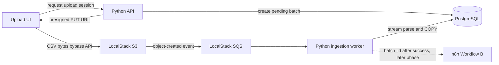

# Loan Eligibility Engine

Event-driven personal-loan eligibility pipeline built for the engineering
intern assignment in this repository.

This branch currently implements **Phase 1 and Phase 2 only**:

- a local PostgreSQL database with the application schema;
- self-hosted n8n in Docker;
- local AWS-compatible S3 and SQS through LocalStack;
- a Python upload/ingestion service;
- a minimal CSV upload UI;
- direct-to-object-storage uploads and asynchronous CSV ingestion.

Loan discovery, matching, LLM use, and notification workflows are intentionally
not implemented yet. AWS deployment is also deferred.

## Local architecture



This uses the same S3 and SQS API boundaries intended for AWS. The upload
endpoint can become a small Lambda/API Gateway handler, the queue consumer can
become an SQS-triggered Lambda adapter, and PostgreSQL can become RDS. The CSV
parser and database persistence code do not depend on FastAPI or LocalStack.

## Why the upload is event-driven

The browser does not send the CSV through the backend. It first creates an
ingestion batch and receives a short-lived presigned URL, then uploads directly
to object storage. S3 emits an object-created event to SQS, and a separate
ingestion worker consumes it. The worker streams the object and uses PostgreSQL
`COPY`, so neither the browser-facing API nor the parser holds the complete
file in memory. The queue also decouples upload traffic from parsing work.

## Prerequisites

- Docker Desktop with Docker Compose
- Ports `4566`, `5678`, and `8000` available

No local Python or PostgreSQL installation is required.

## Start the local stack

1. Copy `.env.example` to `.env`.
2. Replace `POSTGRES_SUPERUSER_PASSWORD` and `N8N_ENCRYPTION_KEY` in `.env`.
3. Leave `N8N_MATCH_WEBHOOK_URL` empty until Workflow B is implemented.
4. Start the services:

   ```bash
   docker compose up --build
   ```

5. Open:
   - Upload UI: <http://localhost:8000>
   - n8n: <http://localhost:5678>

On the first start, PostgreSQL creates separate `loan_engine` and `n8n`
databases with separate application users. LocalStack's ready hook creates the
S3 upload bucket and SQS ingestion queue, applies browser CORS, and registers
the object-created event notification.

The application containers use fixed, private-network-only development
credentials for those two internal database users. PostgreSQL is not published
to the host. Production credentials will be supplied through AWS configuration
in the later deployment phase.

Data is persisted in named Docker volumes. To deliberately remove all local
data and rerun database initialization, stop the stack and remove its volumes
before starting it again.

## CSV contract

Files must be UTF-8 CSVs with exactly these headers (column order does not
matter):

```text
user_id,email,monthly_income,credit_score,employment_status,age
```

Every field is required. `monthly_income` must be a non-negative number;
`credit_score` and `age` must be whole numbers. A malformed row fails the whole
batch and rolls back all rows from that file. Duplicate `user_id` values within
one batch are rejected.

The UI polls the batch endpoint and displays whether processing is pending,
processing, completed, or failed, including the stored row count or validation
error.

## Phase 1–2 endpoints

- `POST /api/uploads` — creates a batch and returns a presigned upload URL.
- `GET /api/batches/{batch_id}` — returns ingestion status.
- `GET /health` — verifies that the service can reach PostgreSQL.

LocalStack S3 sends object-created messages to SQS automatically. The dedicated
`ingestion-worker` service long-polls that queue; no public event endpoint is
needed.

## Database schema

[`db/schema.sql`](db/schema.sql) defines:

- `ingestion_batches` for object/event correlation and processing state;
- `users` for validated user data;
- `loan_products` for the later discovery workflow;
- `matches` for the later matching and notification workflows.

The ingestion callback is idempotent: only a `pending` batch can be claimed,
and users are unique by `(batch_id, user_id)`.

## n8n boundary

n8n is running and persists its own state in PostgreSQL, but no workflow JSON
is created in these phases. When Workflow B is implemented, set
`N8N_MATCH_WEBHOOK_URL` and `N8N_WEBHOOK_SECRET`. After a successful database
commit, the backend sends only the `batch_id` and the secret header to that
webhook. A failed webhook does not roll back successfully ingested users; its
error is recorded on the ingestion batch.

LLM and AWS SES credentials are not needed in Phases 1–2. They will be stored
in n8n's credential store when the workflows that use them are implemented,
not in source files or exported workflow JSON.

## Current phase boundary

The following assignment work remains intentionally untouched:

1. Workflow A: scheduled public-site loan product discovery.
2. Workflow B: optimized SQL/rules/LLM eligibility matching.
3. Workflow C: AWS SES notifications to controlled test aliases.
4. Workflow JSON exports, complete assignment documentation, demonstration
   video, and final AWS/Serverless deployment artifacts.
